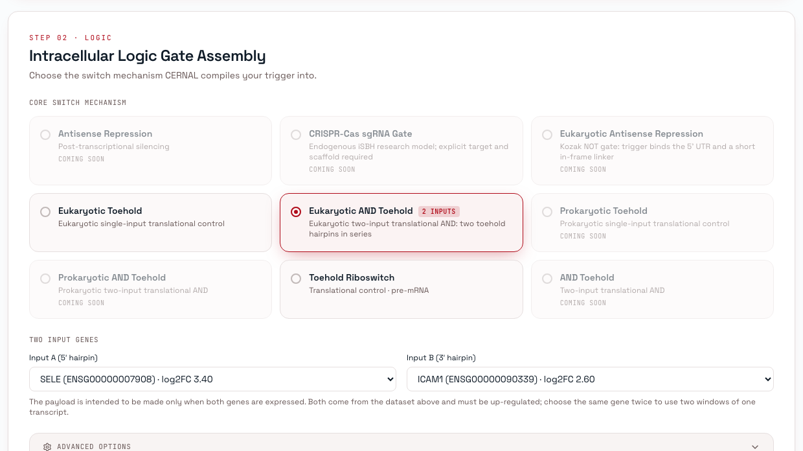
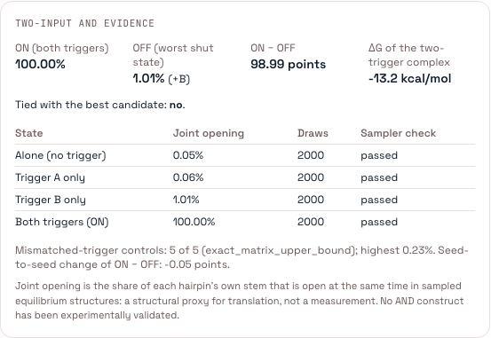

# Two-input AND gates

The application has two distinct two-input chemistries. Select one family per run:
`prokaryotic_toehold_and` for the E. coli equilibrium model below, or
`eukaryotic_toehold_and` for the Human/yeast joint-stem sampler described afterward.
Their probabilities, state definitions and search settings are not interchangeable.

## Bacterial equilibrium AND (E. coli)

Choose **E. coli**, a **DE dataset**, and `prokaryotic_toehold_and`. The normal
CERNAL stages select genes and accessible trigger windows. The gate-specific search
consumes that shortlist; it does not discover overlaps elsewhere in the transcripts.
Only pairs from **different genes** are considered. `and_inputs` is an optional
restriction to two selected up-regulated genes, not a required manual selection.
Direct-sequence and Specific Gene modes cannot provide this input pool.

Set `constraints.max_triggers` to 2 and `max_circuit_gates` to 1. Family options go
in `prokaryotic_and`, distinct from the eukaryotic `and_gate` block.

1. Find reverse-complementary runs of at least 4 nt inside the upstream regions.
   Keep maximal runs within the architecture's invasion limit; consider both roles.
2. Derive complete A/B footprints around the overlap, including when it lies at an
   upstream window edge. These footprints may extend outside a nominated region,
   but must fit their reference transcript: A/B are 36/50 nt (naive) or 35/49 nt (Kim).
3. Score each adjusted footprint using `TriggerScorer.score_window`, also used by
   upstream scanning. This uses the existing RNAplfold gate-aware joint P8 method,
   terminal-20 diagnostics and model provenance. Reuse unchanged upstream records.
   The AND pair order uses the lower of the two trigger scores. This reduction to
   a pair score is a declared selection policy, not a calibrated AND success probability.
4. By default, group complete pair/role/geometry records by maximal overlap length.
   Reserve one slot per observed length when K permits, then fill remaining slots toward
   proportional quotas from the eligible pool. Within each length, prefer higher minimum
   partner accessibility. If K is smaller than the number of lengths, represent the lengths
   with the best available pair scores. Record both length distributions and whether all
   lengths were represented. `top` and seeded `percentile_sample` remain explicit alternatives.
   Discovery limits make these distributions properties of the discovered eligible pool.
5. Vary only the seven secondary-stem conflicts nearest x; fix farther conflicts to lock+B.
   Enumerate all 3**min(n,7) assignments unless an explicitly tighter cap requests a sample.
   Evaluate full binding-region energies and B's full invasion alignment, including fixed
   positions and any scaffold cap in the lock. Explore the declared lever grid, rotating
   grid starts and interleaving pairs/stems. A-anchored stems face the same checks as
   other stems; their label never directly excludes them. An empty sampled stem set
   means none was found within that sample, not proof that the pair is unbuildable.
6. Validate assemblies, measure equilibrium states and collect all 22 feasibility
   violations. Apply shared scoring/construct checks and rank survivors. Missing
   measurements are None, never zero. Retain rejected records with their reasons.

**Folding boundary:** the complete generated switch through the linker, **excluding
all output CDS**. The historical base scaffolds are 161/165 nt; architecture and
sequence choices can change the actual generated length, which is recorded. There
is no output-prefix screen or mandatory full-CDS finalist stage. The assembled and
exported constructs still contain the complete requested output. This deliberate
model scope does not establish that distal output interactions are absent.

| Option | Meaning / pilot default |
|---|---|
| `max_pair_candidates`, `max_pair_seed_matches` | Discovery/storage caps, both 50,000; record truncation before sorting |
| `max_pairs` | Whole compatible pairs carried, 8 |
| `pair_selection`, `accessibility_percentile` | `overlap_stratified` by default; `top` or seeded `percentile_sample` (50th percentile boundary) are explicit alternatives |
| `max_variable_conflicts` | 7 conflicts nearest x; all farther conflicts fixed at lock+B |
| `stems_per_pair`, `max_stem_assignments` | Up to 3 selected stems; at most 2,187 assignments per pair/geometry before Pareto pruning |
| `max_attempts` | 160 attempted assemblies, including invalid ones |
| `geometry` | `naive` (default), `kim`, or `both` |
| `closure_set`, `upper3_set` | `chosen` / `aua_only`: five closures, AUA upper3, original lower3 plus an eligible strengthening variant; at most 10 points per stem. `compact` and `full` retain comparison grids |
| `on_ceiling` | 7.2 kcal/mol ON-state screen; not a kinetic threshold |
| `budget.max_designs` | Validated gate designs evaluated, default 20, ceiling 1,000 |
| `budget.max_runtime_seconds`, `on_exceed` | Optional cooperative search deadline, integer 1..259,200 seconds, `return_partial`; count budgets remain active |

Use small count/time limits for demonstrations and larger explicit limits for full
searches. Hours to a few days are acceptable when the chosen search and execution
environment permit them; no seconds-only performance target is imposed.

The assignment cap 2,187 = 3^7 was an initial engineering budget, not a model-derived
conflict count or a validated optimum. A pair with n conflicts has 3^n assignments.
The cap does not mean 2,187 hairpins are carried to four-state folding; if it samples
the restricted space, the resulting Pareto front describes only those sampled assignments.
Search evidence records the complete conflict list, variable and fixed positions (zero-based,
from x toward the loop), unrestricted and restricted assignment counts, and whether the
restricted space was enumerated completely. This distinguishes restricted enumeration
from an exhaustive search over all conflicts. Research constructors keep
`max_variable_conflicts=None` by default, preserving historical unrestricted sweeps.

The default length coverage and three strong-lock-row A-site bins retain alternatives
whose performance ordering has not been validated experimentally. Proportions are
approximated subject to minimum coverage; rare lengths can be deliberately overrepresented.
No preference for long overlaps or a particular A-site bin is asserted.


Production selection keeps the strongest-lock row (most negative lock tertile) of
the existing global 3x3 lock/A-site-energy grid. One representative nearest each
occupied cell's mean is selected, up to three. Empty cells are not filled using
weaker lock rows or by repartitioning the A-site axis. The exact selected count and
front size are stored under `secondary_selection`.

The five closures already implement one control plus four closure-depth classes:
original, AUG (0 paired positions), AAC (1), AGU (2), CGU (3). AAC/AGU/CGU have the
fixed-alignment energy nearest their class mean against AUG, at the correct
antiparallel register. The zero-pair class has no distinct energetic centre, so
AUG is a well-represented external Green reference. It is not a demonstrated
best-performing choice. Current production uses AUA upper3 only. Lower3 considers
eligible AU-to-GC substitutions below the existing 2S1W target and keeps a wobble
variant only if the complete lower arm's shared fixed-alignment energy decreases;
GC-to-AU weakening and no-op duplicate designs are omitted. The 22 four-state
checks and common ranking profile remain unchanged.

Queued submissions automatically receive a search deadline derived from the deployed
worker timeout and execution timeout, reserving up to 60 seconds for finishing and
saving results (currently 3,540 seconds against the 3,600-second worker). Both API
submission paths and dry-run resolution enforce the same ceiling; requests above it
are refused explicitly. Longer searches can use `LocalEngine` outside that queue, or
require the platform owner to configure longer worker limits. This change does not
raise deployment timeouts. Checkpoints occur during region discovery, footprint
scoring, stem assignment and generation, and between complete equilibrium evaluations.
A native folding call is not preempted; this is not a hard wall-clock guarantee.
Completed candidates survive a search deadline; user cancellation remains cancellation.

The normal frozen `TriggerCandidate`, `TriggerSet`, `GateDesign` and candidate records
are the inter-stage interface. CSV is an export. `candidates.csv`, `and-search.json`
and the run manifest retain coordinates, design axes, context length/hash, all four
states, checks, rejection reasons, counts, seed, settings and reference/model versions.
Four-state diagnostics use `prokaryotic_equilibrium`: 00 alone, 10 A, 01 B, 11 both.
ON/OFF values are joint equilibrium opening probabilities of the 30-nt initiation
window and opening costs; OFF is the worst of all three OFF states. They are structural
proxies, not measured translation or kinetic rates. Historical barrier investigations
remain separate. Sequence downloads retain existing release checks. Physical
multi-gate circuit assembly remains outside this one-gate production path.

### Bacterial candidate audit and ranking

`and-candidates.json` (`and-candidate-audit-v1`) is a sequence-free export of the
existing `CandidateResult` records, sorted by rank then stable reference, with
unranked rejects last. It includes explicit A/B roles, transcript intervals and
reference/sequence hashes, domain coordinates, stem energies, lever settings,
four-state observations, all 22 individual check values/thresholds/statuses, and
raw/normalized metric decomposition. Each candidate's `equilibrium.ranking_profile`
records the actual resolved profile, including request overrides, missing-value
rules, normalization ranges, hard filters and tie-breakers. The run manifest and
`and-search.json` supply input/seed/budget/search-scope provenance. Full sequences
stay in the internal candidate record; released sequence downloads retain the
existing screening requirements. CSV adds the nine raw shared metrics, ON-minus-OFF
and raw ON/OFF ratio. Blank/null means unmeasured; rejected records have no rank.

The default is `default-v3-computational-proxies`: a weighted mean of metrics
clamped/normalized to declared ranges, with lower-is-better terms inverted.
For bacterial AND, OFF is max(P00, P10, P01); `predicted_leakage` is OFF,
`dynamic_range` is P11/OFF, and `state_separation` is its log2 equivalent from
opening energies. No ratio floor is applied; a zero/missing OFF gives a missing
ratio. `ranking_measures.on_minus_off` is diagnostic, not a new scored metric.
The existing shared filters (leakage <= 0.85; separation >= 0.5) are additional to
the 22 structural checks. This revision does not change them or introduce a new
feasibility gate. Changing those shared rules requires a separate scoring decision.

The common schema permits downstream consumption, but **does not establish
cross-architecture biological comparability**. Single-input AUG marginal opening,
bacterial AND joint-window opening, and eukaryotic joint-stem sampling describe
different events. AND also leaves uncalibrated success/complexity metrics missing,
which the default profile penalizes. Keep family identity, raw states and score
decomposition visible; do not interpret the aggregate as calibrated protein output.
An ON/worst-OFF Pareto comparison is a proposed supplementary baseline, not an
implemented replacement for the shared rank.

For the scientific revision, current yield limitation and reproducible local audit,
see [the review report](evidence/prokaryotic-and-revision-2026-10-18.md).

### Off-target research and compiler boundary

[`off_target_scan.py`](../src/engine/gates/notebooks/toehold_and/off_target_scan.py)
implements two historical same-transcript questions: can another window fire the gate
(`Q_false`), or block activation by its intended inputs (`Q_fail`)? It searches repeated
recognition sequences outside the intended window, then optionally compares switch+decoy
with switch alone and switch+A+B+decoy with switch+A+B. The folded second pass uses one
baseline construction per pair; its verdict must not be copied to every lever variant.
This research driver is not called by the production compiler and is not a genome-wide
screen of the PFOA input genes. Production continues to report `off_target_screen=unmeasured`;
no missing measurement becomes a clean result or an additional feasibility filter.


## Eukaryotic joint-stem AND

`eukaryotic_toehold_and` designs a **two-hairpin toehold construct** that is meant to make its
payload only when **two** chosen RNAs are both present. It is the first gate with two inputs that
can be chosen in the application, run by the worker, saved with the run, reopened and exported.
It is a computational design: **no AND construct has been experimentally validated.**

Science and definitions: [`notebooks/toehold_and/eu_and_v3_spec.md`](../src/engine/gates/notebooks/toehold_and/eu_and_v3_spec.md).
The code that measures it is one shared module,
[`engine/gates/tools/stem_opening.py`](../src/engine/gates/tools/stem_opening.py), used by this gate
and by the `eu_and_v3` notebook, so the two cannot report different numbers.

## What is supported

| | |
|---|---|
| Hosts | `human`, `yeast` (a bacterial host is refused: `not production supported for ecoli`) |
| Inputs | a **differential-expression table** and two genes picked from it (the same gene twice is allowed: two windows of one transcript). A pasted sequence or a single reference gene cannot name two inputs and is refused |
| Genes | both must pass gene selection and be **up-regulated**; a down-regulated or filtered gene fails the run naming the gene and the stage-1 reason |
| Outputs | the same as any Human or yeast run (GFP, mCherry, luciferase, custom coding sequence) |
| One run | one AND gate; it is not combined with single-input families in the same run |

`GET /api/version` states this, and the wizard and the API both read it:
`family_hosts`, `family_inputs` (`eukaryotic_toehold_and: 2`), `family_input_modes` (`["de"]`) and
`limits.max_gate_inputs` (2). The single-input default is unchanged (`limits.max_triggers` is 1), and
naming no family never selects the AND gate.

## Using it in the application

1. **Step 1 · Inputs.** Choose **Human** or **Yeast**, then a differential-expression dataset
   (public or uploaded).
2. **Step 2 · Logic.** Choose **Eukaryotic AND Toehold** (marked *2 inputs*). The input modes that
   cannot name two genes are disabled, and two selectors appear, listing the dataset's
   up-regulated genes: **Input A** (5′ hairpin) and **Input B** (3′ hairpin).
3. Choose a payload and vector as usual, then **Compile & Optimize**.
4. Open the run. Each candidate shows its score decomposition and an **AND evidence** panel: ON,
   OFF, ON − OFF, ΔG, whether it is tied with the best, every folded state with its sampler check,
   and the controls. Unmeasured values read *unmeasured*; a failed sampler check reads **FAILED**
   and is repeated as a warning.
5. Download the summary table (extra `and_*` columns), the report, and, only once sequence release
   is approved, the FASTA, GenBank and SBOL files.

The gate and its two genes are chosen in step 2 (screenshot of the running application):



and each candidate's page shows what its ON and OFF came from:



## The same run through the API

```http
POST /api/runs
{
  "input_mode": "de",
  "dataset_id": "<id of an uploaded DE table with SELE and ICAM1>",
  "organism": "human",
  "gate_families": ["eukaryotic_toehold_and"],
  "seed": 7,
  "params": {
    "constraints": {"max_triggers": 2, "max_circuit_gates": 1},
    "and_inputs": {"gene_a": "SELE", "gene_b": "ICAM1"},
    "payload": {"outputs": ["gfp"]},
    "budget": {"max_designs": 8}
  }
}
```

`max_triggers` must say 2 (one gate with two inputs), `max_circuit_gates` stays 1, and `and_inputs`
is required. `params.and_gate` is optional and accepts the settings below; unknown names and
out-of-range values are a `422` naming the field. `POST /api/design` accepts the same
`and_inputs` and `and_gate` fields.

### One real run

Human, the table `ENSG00000007908 SELE log2FC 3.4` and `ENSG00000090339 ICAM1 log2FC 2.6`, default
settings, seed 7, ViennaRNA. It finishes in about **50 s** on a laptop: 8 candidates, all accepted,
a tied group of 2, and **32 of 32** sampler checks verified.

| rank | spacer | ON % | OFF % | OFF set by | ON − OFF | tied | ΔG kcal/mol | score |
|---:|---|---:|---:|---|---:|:-:|---:|---:|
| 1 | none | 100.00 | 0.89 | +B | 99.11 | yes | −17.3 | 0.624 |
| 2 | none | 100.00 | 0.89 | +B | 99.11 | yes | −17.5 | 0.624 |
| 3 | none | 100.00 | 1.26 | +A | 98.74 | no | −19.0 | 0.620 |
| 4 | none | 100.00 | 1.32 | +A | 98.68 | no | −19.0 | 0.618 |
| 5 | spacer | 100.00 | 1.32 | +B | 98.68 | no | −17.6 | 0.615 |
| 6 | spacer | 100.00 | 1.48 | +B | 98.52 | no | −18.5 | 0.609 |
| 7 | spacer | 99.87 | 1.67 | control | 98.20 | no | −14.3 | 0.593 |
| 8 | spacer | 99.97 | 1.86 | control | 98.11 | no | −14.5 | 0.587 |

The seed-to-seed noise of ON − OFF was 0.09 points (median) and 0.14 (95th percentile), so the two
best candidates are the tied group and the rest are not clearly worse than each other. **What the
numbers do not say:** they are structural predictions at 37 °C and 0.1 M salt, not measured
expression. The leak that sets OFF is almost always one trigger partly opening the *other*
hairpin (`+A`, `+B`), not the bare construct.

## What is computed

1. **Genes and windows.** Stage 1 runs on the two chosen genes only. Stage 2 scans their
   transcripts; for this gate a window containing `AUG` or `CAU` is skipped (the hairpin is built
   from the window and from its reverse complement, so either puts a second start codon into the
   switch), and `windows_per_gene` distinct, non-overlapping windows are kept per gene.
2. **Single switches.** The inherited toehold sweep builds each trigger's hairpins in the
   *trailing-Kozak* layout (prefix, toehold, stem↑, loop, stem↓, Kozak, AUG). The
   `singles_per_trigger` best of each trigger, by sampled `ON − OFF` of the single switch, go on.
3. **Fusing.** For both orders (A at the 5′ end, then B), each pair of single switches and each
   spacer variant, the first hairpin is cut at its own Kozak and the second hairpin joined after its
   prefix. Every relocated domain is checked to hold its original sequence. The designs are sorted
   by the screen scores of their halves, so `budget.max_designs` keeps the most promising.
4. **Validation.** The shared `SwitchValidator`: exactly one start codon (the payload's), no
   in-frame stop, no forbidden motif, a target structure that folds. A rejected design keeps its
   reason in the run summary.
5. **Evaluation.** For the fused switch plus the first 30 nt of the payload after the start codon,
   the four states (alone, +A, +B, +A+B) and `n_controls` mismatched-trigger controls are folded;
   `n_samples` structures are drawn from each sampled state, and
   `Open = E[min(rA/LA, rB/LB)]` is the joint opening of the two stems, each relative to its own
   length. **ON** is the +A+B state; **OFF** is the largest of alone, +A, +B and the controls. A
   second sampling with another seed gives the noise that defines the tied group.
6. **Checks.** Each sampled state is compared with the exact base-pair probabilities; a failed
   check is kept, shown and counted, never corrected.

Scored metrics are the profile's own names, raw: `predicted_leakage = OFF/100` (a structural proxy,
not a measured leak), `dynamic_range = ON / max(OFF, 1%)`, `state_separation` its log2,
`gate_folding_energy` the MFE, `trigger_accessibility` the lower of the two triggers',
`gc_content`, `predicted_success_rate`, and `circuit_complexity` 3. `orthogonality` is not emitted.

## Settings (`params.and_gate`)

| Field | Default | Meaning |
|---|---:|---|
| `n_samples` | 2000 | structures drawn per sampled state |
| `screen_samples` | 300 | draws used to rank single switches before fusing (ordering only) |
| `n_controls` | 5 | mismatched-trigger controls per candidate |
| `controls_sampled` | false | `false`: each control's exact-matrix upper bound; `true`: sample it (ViennaRNA's sampler can disagree with its matrix on mismatched states, so the bound is the default) |
| `windows_per_gene` | 3 | distinct trigger windows kept per input gene |
| `singles_per_trigger` | 3 | single-switch variants of each trigger that are fused |
| `spacer_variants` | both | `no_spacer`, `spacer` |
| `spacer_min_length`, `spacer_max_length`, `spacer_pool_size` | 15, 20, 150 | the seeded spacer pool |
| `max_overlap_nt`, `wobble_max_fraction` | 8, 0.5 | longest identical or complementary run allowed between the two triggers and a control and a trigger |
| `verify_sigma`, `verify_floor_nt` | 4.0, 0.02 | sampler-check tolerance `σ·sd/√N + floor` |
| `off_floor_pct` | 1.0 | OFF below this is replaced by it in `dynamic_range` only |
| `noise_check`, `noise_seed_offset` | true, 1000 | second sampling that defines the tied group |

The folding model defaults to **0.1 M monovalent salt** for an AND run (the ViennaRNA library
default, 1.021 M, is a standard state, not a cell); set `params.folding.salt_molar` to override. The
effective value is recorded in the run's configuration and its folding-model provenance.

## What is saved

Everything is saved with the run and survives reopening: the gate family and its version, the
frozen configuration (both genes, the settings, the folding model), each candidate's two triggers,
metrics, `design.and_gate` (state-by-state Open, sampler checks, controls, ΔG, tie, noise),
warnings and rejection reasons, and the run's `scientific_provenance.and_gate` (settings, noise
band, tied group, sampler-check totals). Rejected candidates are kept with their reason and no
rank. The sequence-release checks are unchanged: with no screening adapter configured the
sequences, the manifest and the sequence exports are withheld, while `design.and_gate` (numbers
only) is disclosed through an explicit whitelist.

## Limits and open questions

- **No experimental validation**, and no sensitivity analysis of the declared defaults (8 nt
  overlap, 5 controls, 0.1 M salt) has been run.
- **Different switches than the notebook.** The single switches come from the engine's own
  generator (same prefix, 18 nt stem and `GCCACC` Kozak as the NucSyn designs `eu_and_v3` fuses),
  not a NucSyn table, so numbers are not expected to match a notebook run on the same genes.
- **Ranking.** `engine.scoring` ranks the candidates (weighted score over the profile's metrics),
  not `ON − OFF` alone; the tied group is reported beside the ranking, not used to reorder it.
- **`gate_folding_energy` saturates.** Two stable hairpins have an MFE near −80 kcal/mol, below the
  profile's −60 floor, so the normalised score is its best for every AND candidate and does not
  discriminate between them. The raw value is reported unchanged; a per-gate range is a profile
  decision.
- **Controls** are windows of other transcripts of the host's reference (seeded), not the notebook's
  triggers of other designs.
- **Payload.** Only the first 30 nt after the start codon are folded, as in the notebook; whether
  the rest of the payload changes the ranking is untested.
- **Compute.** About 2–3 s a candidate at the defaults; `budget.max_designs` bounds the number
  evaluated (default 20).

## Tests

- `tests/api/test_and_gate_run.py`: the flow above through the real stack (capabilities,
  submission, worker, saved results, reopening, exports, the release gate, rejections, bad inputs,
  every unsupported combination, and a single-input run still working).
- `tests/engine/gates/test_eukaryotic_and_gate.py`: the family, its settings and the shared tool.
- `frontend/e2e/and-gate.mjs` (`npm run test:and`): the evidence panel.
- The notebook's own tests still pass on the shared tool.
